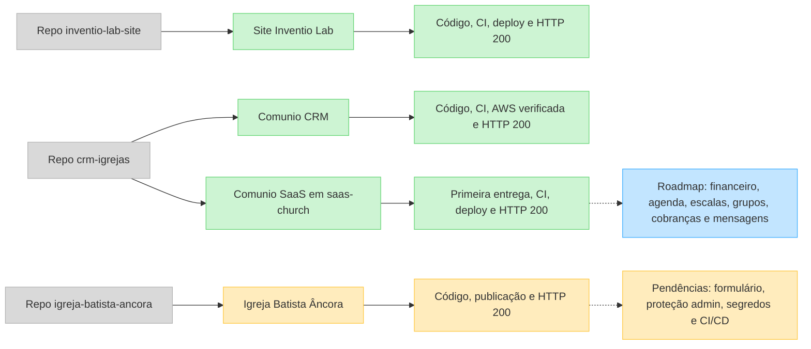
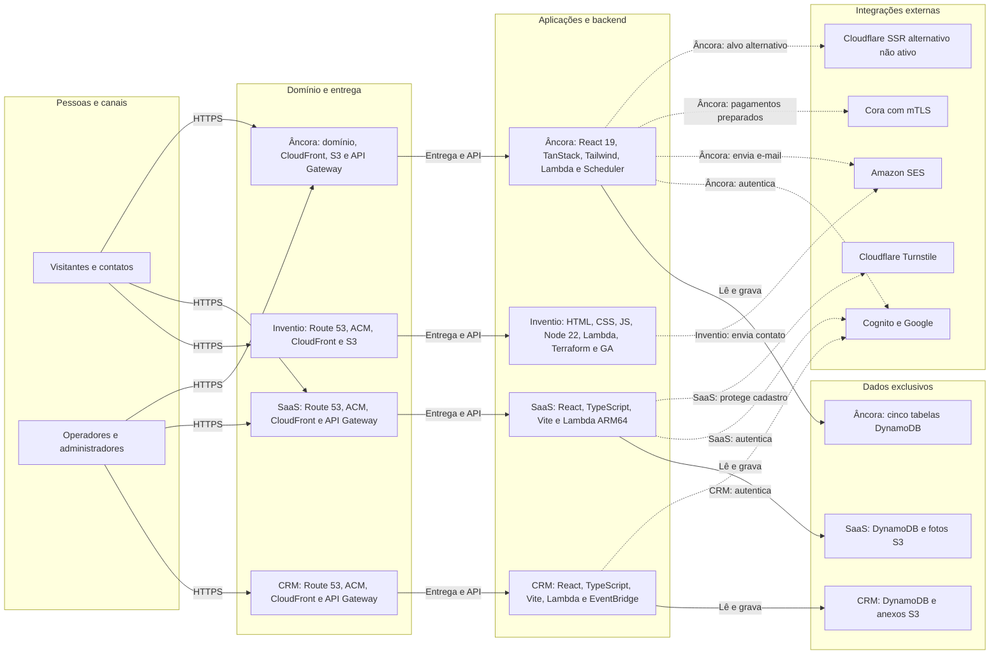
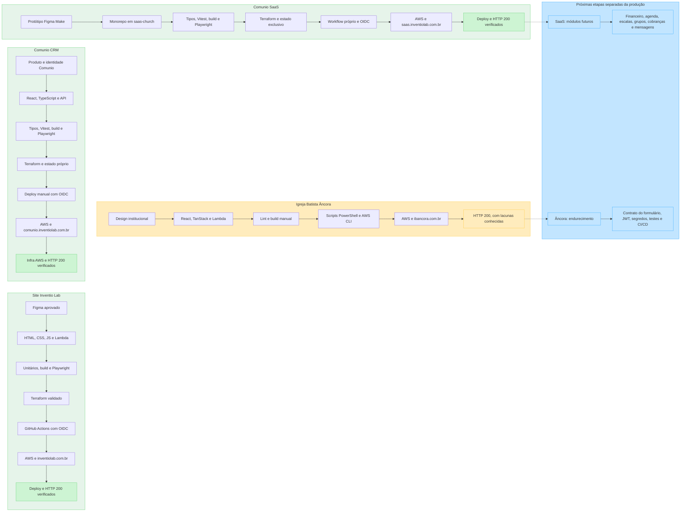

# Ecossistema Inventio Lab — implementação, arquitetura e entrega

> Fotografia técnica verificada em **12/10/2026**. Este documento não é um dashboard em tempo real: ele registra o que foi encontrado nas branches principais, na documentação dos projetos, nas execuções do GitHub Actions e em verificações HTTP não destrutivas feitas nessa data.

Este mapa cobre os quatro sistemas mantidos nos três repositórios da organização Inventio Lab:

- [Site Inventio Lab](https://github.com/Inventio-Lab/inventio-lab-site)
- [Comunio CRM](https://github.com/Inventio-Lab/crm-igrejas)
- Comunio SaaS, aplicação independente mantida em `saas-church/` dentro do repositório `crm-igrejas`
- [Igreja Batista Âncora](https://github.com/Inventio-Lab/igreja-batista-ancora)

## Legenda de estado

| Cor | Significado |
|---|---|
| Verde | Publicado e validado por evidência técnica recente |
| Amarelo | Publicado, mas com pendências relevantes conhecidas |
| Azul | Planejado ou próximo passo; não confundir com produção |
| Cinza | Repositório, contexto ou alternativa que não representa o caminho ativo |

Os estados são independentes: **implementado** significa que o caminho existe no código; **validado** indica testes automatizados ou uma verificação operacional documentada; **publicado** indica evidência de deploy e endereço acessível; **verificado operacionalmente** exige uma checagem além da presença do código. Uma resposta HTTP `200` confirma disponibilidade da página, não todos os fluxos autenticados ou integrações.

## 1. Portfólio, maturidade e roadmap

### Leitura do estado

- **Site Inventio Lab:** frontend institucional, formulário real por API/SES, analytics com consentimento, infraestrutura e deploy automatizado. A execução de validação e publicação da `main` foi concluída com sucesso em 10/10/2026.
- **Comunio CRM:** funil comercial, contatos, atividades, contratos, entregas, anexos e importação estão implementados. O endereço está publicado e a verificação de infraestrutura AWS via OIDC foi concluída com sucesso em 10/10/2026.
- **Comunio SaaS:** a primeira entrega cobre membresia, ministérios, importação/exportação, fotos, isolamento por igreja, login Google e autocadastro com Turnstile. O workflow validou e publicou a aplicação em 10/10/2026. Os módulos mostrados como roadmap não fazem parte dessa primeira entrega.
- **Igreja Batista Âncora:** site, conferência, captação, painel, campanhas e integrações serverless existem e o domínio está online. O próprio repositório registra que o contrato do formulário de interesse precisa ser alinhado, que o authorizer JWT da rota administrativa depende de configuração externa, que credenciais Cora ainda são empacotadas no deploy atual e que não há suíte automatizada de testes nem workflow de CI/CD equivalente aos demais sistemas.

## 2. Arquitetura e tecnologias

O diagrama agrupa cada produto como uma unidade de alto nível para permitir a comparação. As caixas de dados representam recursos exclusivos de cada sistema; não há banco ou API compartilhada entre os produtos.

### Tecnologias transversais

- **AWS:** os quatro sistemas usam hospedagem e/ou serviços serverless na AWS, mas mantêm recursos e dados próprios. Route 53 e ACM sustentam os domínios; CloudFront e S3 entregam os frontends; API Gateway e Lambda atendem os backends.
- **Identidade:** Comunio CRM, Comunio SaaS e o painel da Igreja Âncora usam Cognito com Google. O site institucional da Inventio não exige login.
- **Infraestrutura como código:** Site Inventio, Comunio CRM e Comunio SaaS usam Terraform. Igreja Âncora usa scripts PowerShell/AWS para a publicação principal; a configuração Cloudflare é uma alternativa SSR, não o caminho de produção documentado.
- **Qualidade:** Site Inventio usa testes nativos do Node e Playwright; CRM e SaaS usam TypeScript, Vitest e Playwright; Igreja Âncora documenta lint e build, mas não possui suíte automatizada configurada no `package.json`.

## 3. Caminho de implementação, validação e deploy

## Evidências da fotografia

| Sistema | Produção verificada | Evidência de entrega ou operação | Limite da evidência |
|---|---|---|---|
| Site Inventio Lab | [inventiolab.com.br](https://inventiolab.com.br) — HTTP 200 em 12/10/2026 | [GitHub Actions: validação e deploy aprovados em 10/10/2026](https://github.com/Inventio-Lab/inventio-lab-site/actions/runs/38074416700) | A checagem HTTP não envia o formulário |
| Comunio CRM | [comunio.inventiolab.com.br](https://comunio.inventiolab.com.br) — HTTP 200 em 12/10/2026 | [GitHub Actions: verificação AWS aprovada em 10/10/2026](https://github.com/Inventio-Lab/crm-igrejas/actions/runs/38070445516) e documentação de implantação do repositório | A sessão autenticada não foi reexecutada nesta fotografia |
| Comunio SaaS | [saas.inventiolab.com.br](https://saas.inventiolab.com.br) — HTTP 200 em 12/10/2026 | [GitHub Actions: validação e deploy aprovados em 10/10/2026](https://github.com/Inventio-Lab/crm-igrejas/actions/runs/38070452246) | A checagem HTTP não cria membros nem igrejas |
| Igreja Batista Âncora | [ibancora.com.br](https://ibancora.com.br) — HTTP 200 em 12/10/2026 | README, scripts e histórico da branch `main` do [repositório](https://github.com/Inventio-Lab/igreja-batista-ancora) | Não há workflow de CI equivalente; fluxos com dados pessoais e pagamentos não foram acionados |

## Regras para atualizar este documento

1. Atualize a data da fotografia e preserve a distinção entre código, validação, publicação e operação.
2. Use apenas evidências da branch principal, documentação vigente, execução de CI/CD ou verificação operacional segura.
3. Não marque roadmap como entregue e não infira integração entre produtos pelo simples uso dos mesmos serviços AWS.
4. Não inclua IDs de conta, ARNs, segredos, tokens, certificados, dados pessoais ou URLs internas sensíveis.
5. Ao mudar um diagrama, atualize a versão correspondente no FigJam para manter as duas fontes alinhadas.
